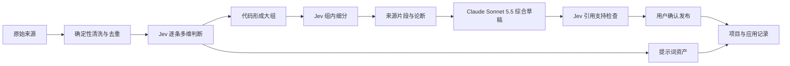

# OmniHub 知识炼化系统规划

> 规划基线为 2026-09-24。首版数据管线与仓库库、知识库、提示词库页面已按本规划实现；后半部分继续保留长期演进目标。

## 0. 首版实施结果

本次对 1,857 条本地 X 来源完成了全量多维判断。分类结果保存来源形态、主要去向、内容完整度、复用价值和可提取资产，并保留 Jev 版本、概率和复核状态。1,430 条仍需要补全文本或外链内容，1,608 条至少有一个复核原因；它们保留在复核数据里，没有为了让数字好看而强行写成确定分类。

首版已经形成三类可直接使用的资产。

- GitHub 仓库库：597 个规范化仓库，关联 798 条来源关系和 670 个不同入口；公开访客当前可见 593 个仓库，其余仓库只关联非公开来源。
- 提示词库：对 138 条原提示词候选完成二级判断，确认 92 条完整可复用提示词；页面支持用途、主体和风格交叉筛选。
- 知识库：完成 Obsidian 长期上下文、OpenClaw Skills 选择、Seedance 提示词结构三篇首批文章，共关联 16 条来源和 33 条可核验结论。Claude Sonnet 5.5 负责综合，Jev 对 33 条结论逐条检查，最终全部为已支持、无待复核项。

原始 X 正文、来源 URL、作者、时间、媒体和 GitHub 深链都继续保留。知识文章和仓库档案只新增关联，不覆盖来源内容。页面已经通过桌面端 1440 × 1024、移动端 390 × 844 的真实浏览器检查；公开 API 只返回公开来源，仓库状态修改仍要求所有者权限。

## 1. 这次改造要得到什么

OmniHub 需要把收藏内容变成可以再次使用的个人知识。X 收藏、文章、视频和提示词继续完整保存，它们构成来源层。系统从来源中提取可引用的片段，把多条相互支持或相互补充的材料组成知识草稿。用户确认以后，这份草稿才成为一篇正式知识文章。

知识文章要能持续更新。新来源出现时，系统提出补充建议，用户决定是否形成新版本。已经发布的正文不能被自动覆盖。

提示词走另一条路径。原始提示词逐字保留，系统可以另外生成变量化模板、适用说明和分类建议。用户以后找提示词时，可以同时按用途、主体、风格、场景和工具筛选，不必猜它被放进了哪个文件夹。

信息流继续负责发现。首页、知识库和提示词库负责整理、检索和复用。

## 2. 当前数据盘点

本次只读检查覆盖了 xarchive 快照和本地 `data/app.db`。当前数据量已经足够暴露原有分类模型的问题。

### 2.1 来源规模

| 项目 | 当前结果 | 说明 |
| --- | --- | --- |
| xarchive 快照记录 | 1,862 | 其中 1,859 条可用，3 条不可用 |
| 本地数据库 X 条目 | 1,857 | 与快照相差 2 条，实施迁移前需要逐 ID 对账 |
| 网站公开可浏览 | 1,472 | 当前生产页面显示的数量 |
| 已忽略 | 375 | 需要保留处理记录，不能在迁移时重新冒出来 |
| 未复核可见性 | 377 | 迁移前需要继续沿用可见性状态 |
| 私有 | 8 | 不得因新页面或公开知识文章泄露 |

xarchive 本次导出由 `pagination_guard` 停止，覆盖范围是 `partial_xarchive_scan`。这些数量不能被写成账号全部收藏。后续完整快照应按帖子 ID 补齐，而不是再建一份重复来源。

来源时间跨度从 2023-09-30 到 2026-09-22。1,090 条收藏带媒体，共有 1,521 个媒体对象，其中图片 1,258 个、视频 259 个、动图 4 个。1,263 条带外链，348 条包含引用推文。这些关系需要继续保留，因为知识引用经常依赖被引用内容和外部文章，而不只依赖收藏帖正文。

### 2.2 现有整理结果

| 类型 | 数量 | 当前缺口 |
| --- | --- | --- |
| 资源 | 1,028 | 资源类型过宽，工具、文章、仓库、课程和产品混在一起 |
| 提示词 | 138 | 仍留在收件箱，正式提示词表只有 11 条 |
| 知识 | 117 | `knowledge` 表仍是 0 条，没有形成正式知识文章 |
| 项目想法 | 7 | 数量少，暂时保留为来源用途，不急着扩成复杂项目系统 |
| 未知 | 567 | 其中 405 条又落在 `other` 主题，需要重新判断价值和完整性 |

现有主题只有视频、图像、软件、加密、产品、工作流、商业和其他八类。它适合浏览，不足以支持知识检索。现有跨作者主题关系有 241 条，覆盖 213 个来源和 34 个具体对象。Obsidian、Hermes、OpenClaw、Seedance、Polymarket 等对象已经能形成主题集合，但这些集合仍然只是来源分组。

这 1,857 条数据库来源已经经过 Jev 粗分，不能把它们当成尚未分类的数据重新开始。现有结果作为第一层路由继续使用，新流程只补来源形态、主要去向、内容完整度和可提取资产。旧判断和新判断都保留版本与概率，方便检查变化。

### 2.3 提示词的实际构成

138 条提示词中，现有主题分布如下。

| 现有主题 | 数量 |
| --- | --- |
| 软件 | 51 |
| 图像 | 44 |
| 工作流 | 19 |
| 视频 | 12 |
| 其他 | 7 |
| 商业 | 3 |
| 产品 | 1 |
| 加密 | 1 |

软件类里混有 AGENTS.md、Claude.md、自定义指令、配置片段和 Agent 工作提示。它们与生图提示词的使用方式差异很大。当前的单主题字段会让用户在“提示词”下面继续面对一条长列表。

第一轮 Jev 二级细分已经覆盖 138 条现有提示词。97 条含有完整提示词，其中 92 条同时被判断为可复用提示词；36 条属于原有粗分误收，另外有 10 条提示词正文缺失、5 条只有描述、2 条内容不完整。可复用提示词中，37 条属于女性角色，11 条带电影感，8 条同时命中女性角色和电影感；图像生成 37 条、视频生成 11 条、Agent 系统指令 19 条。这些维度可以组合筛选，数字之间允许重叠。

全部 X 收藏中的主题也大量交叉。Claude 或 Claude Code 约出现于 343 条，Agent 或智能体约 334 条，提示词约 254 条，Codex 约 220 条，工作流或自动化约 170 条，产品设计或 UI 约 162 条。一个来源往往同时属于产品、工具和方法，强行选一个目录会损失信息。

### 2.4 GitHub 仓库的实际规模

X 收藏中有 541 条来源包含可以规范化为仓库的 GitHub 链接。去重以后得到 597 个仓库资产，保留 819 次链接出现记录和 670 个不同的目标链接。目标链接中既有仓库首页，也有 39 个目录、22 个文件和 6 个 release 链接。115 个仓库被多条 X 来源提到，重复收藏本身有价值，因为这些帖子往往给出了不同的使用场景和评价。

仓库需要成为独立资产。一个仓库只显示一张主卡，多条 X 帖子、目录链接、文件链接和 release 链接挂在主卡下面。首页列表不重复展示同一个仓库，详情页仍能看见每一次收藏留下的语境。

## 3. 推荐的信息结构

系统保留三层数据。来源层保存事实，知识层保存整理结果，应用层记录知识被用在什么地方。处理顺序固定为逐条判断、形成大组、组内细分、综合成文和引用核验。文章没有完成前三步时，生成模型不能提前写知识正文。

### 3.1 数据对象

| 对象 | 用途 | 必须保留的内容 |
| --- | --- | --- |
| `RawSource` | 原始 X 帖子、文章、视频或手动材料 | 原文快照、URL、作者、时间、媒体、引用推文、外链、覆盖范围、可见性 |
| `SourceJudgment` | 保存 Jev 对每条来源的结构化判断 | 问题、选项、结果、概率、模型版本、分类字典版本、处理时间 |
| `SourceSnippet` | 可以被正文引用的最小片段 | 原文、来源 ID、字符范围或段落定位、视频时间戳、片段哈希 |
| `SourceLineage` | 判断多个来源是否只是转述同一个上游消息 | 原始出处、转述来源、重复关系、独立来源标记 |
| `Topic` | 稳定主题或具体对象 | 名称、别名、说明、父主题、合并记录 |
| `ClusterCandidate` | 值得提炼的来源集合 | 主题、来源清单、聚合价值、冲突提示、处理状态 |
| `KnowledgeArticle` | 用户确认后的知识对象 | 标题、摘要、当前版本、状态、可见性、主题和用途 |
| `KnowledgeVersion` | 知识文章每次修改的正文 | 正文、变更说明、创建者、创建时间、使用的来源集合 |
| `Citation` | 连接正文结论和来源片段 | 结论位置、片段 ID、支持状态、确认状态 |
| `PromptAsset` | 可复制和复用的提示词 | 原始提示词、模板版本、变量、模型、参数、效果媒体、来源 |
| `RepositoryAsset` | 去重后的 GitHub 仓库 | owner、repo、规范链接、说明、语言、许可证、活跃状态、保存状态和来源列表 |
| `Attribute` | 多维分类值 | 维度、取值、别名、状态 |
| `ContentAttribute` | 任意对象和属性的连接 | 对象类型、对象 ID、属性 ID、来源、置信度、确认状态 |
| `ApplicationRecord` | 知识或提示词的实际用途 | 关联项目、使用时间、结果、备注 |

`RawSource` 永久保留。知识文章删除或归档时，来源不能跟着删除。一个来源可以产生多条片段，也可以同时支持知识文章和提示词资产。

`SourceJudgment` 保存判断过程，不能只把最终标签写回来源。分类字典、阈值或 Jev 版本变化时，系统可以重跑判断并比较前后差异，不会失去旧结果。

### 3.2 资产分类

资产分类采用多标签。单一的“提示词、资源、知识、想法、未知”继续承担兼容路由，新资产层按下面四组信息保存。

| 维度 | 当前受控值 | 作用 |
| --- | --- | --- |
| 来源形态 | 提示词、教程、代码或配置、模板或清单、仓库、工具或产品、文章、研究报告、精选列表、案例、观点、更新、作品、对话 | 说明原始内容是什么 |
| 主要去向 | 提示词库、代码库、仓库库、模板库、方法手册、知识候选、研究资料、资源库、想法、灵感、跟进、留档、复核 | 决定先送到哪个处理队列 |
| 内容完整度 | 可独立理解、依赖外链、依赖媒体、引用内容缺失、来源不可用 | 决定能否继续提炼 |
| 可提取资产 | 提示词、方法、模板、代码、仓库、资源、数据、研究、知识、工作流、想法、案例、参考、灵感、更新 | 允许一条来源贡献多个资产 |

代码、配置和命令在当前收藏中至少出现 478 次，模板、清单、SOP 或工作流至少出现 160 次，论文或研究至少出现 110 次。它们有独立检索价值，不能继续全部塞进“资源”。

### 3.3 来源独立性

五篇文章提到同一个结论，不一定等于五份独立证据。它们可能都引用同一篇官方公告，也可能只是互相转发。

聚合时需要先识别来源谱系。

- 同一 URL、相同正文或高度重合的转述合并为一条证据链。
- 引用推文和被引用推文建立父子关系。
- 官方原文、当事人说明、二次解读和评论分开标注。
- 知识正文可以综合多个观点，但引用数量不能伪装成独立来源数量。

知识详情页应同时显示“引用 8 个来源”和“其中 4 条独立来源”。

## 4. 提示词库怎样整理

### 4.1 分类方式

提示词不设唯一归属目录。系统使用多维属性，并允许用户保存常用筛选组合。

| 维度 | 建议取值示例 | 解决的问题 |
| --- | --- | --- |
| 资产种类 | 图像生成、视频生成、写作、研究、编程、Agent 指令、自动化 | 先确定提示词用于什么工作 |
| 输入方式 | 文生图、图生图、参考图编辑、文生视频、图生视频、系统指令 | 区分操作入口 |
| 主体 | 女性角色、男性角色、商品、建筑、动物、UI、短剧角色 | 从要生成什么开始找 |
| 场景 | 人像写真、电商图、海报、角色卡、分镜、短剧、教程 | 贴近真实任务 |
| 风格 | 电影感、写实摄影、古风、插画、图鉴、纪实、极简 | 支持审美方向筛选 |
| 镜头与构图 | 特写、全身、逆光、一镜到底、俯拍、分屏 | 供图像和视频提示词复用 |
| 工具或模型 | GPT Image、Seedance、即梦、可灵、Midjourney、Claude、Codex | 避免复制到不适用的模型 |
| 状态 | 原始、待清洗、待测试、已验证、好用、需修改、归档 | 区分能否直接使用 |

“电影感女性角色”会同时命中图像生成、女性角色、人像写真和电影感。用户从任一维度都能找到它。常用组合可以保存为“电影感女性”“短剧分镜”“Agent 系统指令”等视图，这些视图只是筛选条件，不改变提示词本身。

### 4.2 属性治理

Jev 只能从当前维度的受控候选中选择，并允许返回“无合适选项”。它不直接创建正式属性。新词先进入别名候选，经过合并或确认后才能进入属性字典。

- 每个正式属性有稳定 ID、显示名称、别名和停用状态。
- “电影风”“电影感”“cinematic”可以映射到同一个正式属性。
- 主体、场景、风格和工具分开保存，不能把“电影感女性写真”作为一个新标签。
- 自动结果保存概率。低于该维度阈值的判断进入复核队列，不直接用于公开筛选。
- 属性字典带版本号。改名不改 ID，合并时保留旧值到新值的映射。
- 用户手工修正的结果优先，后续批量重跑不能静默覆盖。

### 4.3 提示词详情页

详情页按实际使用顺序排列。

1. 效果图或视频预览。
2. 原始提示词，只读保存，显示来源作者和原帖。
3. 可复用模板，支持变量占位符和版本历史。
4. 适用模型、参数和输入要求。
5. 多维属性，点击任何属性都能进入对应筛选结果。
6. 测试记录，保存成功结果、失败点和复现提示。
7. 相关提示词和已应用项目。

一条 X 帖子如果包含多段独立提示词，应生成多个 `PromptAsset`，它们共同引用同一个 `RawSource`。原帖里的说明文字和提示词正文需要分开保存，不能把整条推文当成一个可复制提示词。

## 5. 知识文章怎样形成

### 5.1 Jev 逐条打标签

对账完成以后，先复用 1,857 条数据库来源已有的 Jev 粗分，再补多标签资产判断。正文不可用的 3 条保存“内容不可用”状态，不能因为无法分类而从处理记录中消失。

每条来源一次提交多个相互独立的窄问题，Jev 返回选项和概率。第一轮只回答下面这些问题。

| 判断维度 | 结果示例 | 用途 |
| --- | --- | --- |
| 内容形态 | 提示词、教程、代码或配置、模板、仓库、工具、研究、新闻、观点、案例、作品展示、闲聊 | 决定后续处理路径 |
| 主主题 | Agent、Codex、个人知识、图像生成、视频生成、产品设计 | 形成第一层大组 |
| 具体对象 | Claude Code、Obsidian、Seedance、OpenClaw | 连接跨作者的同一对象 |
| 使用目的 | 学习方法、直接复用、项目参考、继续跟踪、低价值留档 | 决定整理优先级 |
| 证据性质 | 一手事实、个人经验、二次解读、主观观点、推测 | 控制知识正文怎样引用 |
| 内容状态 | 完整、只有摘要、依赖外链、疑似重复、不可用 | 决定是否可以继续提炼 |

标签结果必须保留判断概率、问题版本和字典版本。低置信度不会阻塞其他内容，它进入单独的人工复核清单。第一轮不生成摘要，也不写知识文章。

### 5.2 先形成大组

确定性代码使用 Jev 标签、具体对象、外链域名、引用关系和文本相似度召回候选。大组回答“这些来源大致在谈什么”，例如 Claude Code、Seedance 视频提示、女性人像生成或 Obsidian 知识管理。

语义相似度只负责召回，不能直接把文章合并。大组要保留进入依据，用户可以看到每条来源因为哪个主题、对象或相似片段被放进来。

同一来源可以进入多个大组。它在每个组里承担的作用可以不同，原始来源仍然只有一份。

### 5.3 Jev 在组内继续细化

大组形成以后，Jev 再判断组内关系。这轮判断使用组名、组内代表内容和候选来源，不重新发明主题。

- 这些来源是否在回答同一个具体问题。
- 某条来源应留在当前组、移到子组，还是只作为背景资料。
- 两条来源是独立证据、同源转述、重复内容，还是互相引用。
- 每条来源在组内承担事实、方法、案例、反例、观点或补充说明中的哪一种作用。
- 组内是否存在无法合并的冲突观点。

一个宽泛的“Claude Code”大组可以继续拆成上下文管理、权限设置、Agent 配置、成本控制和使用案例。细分结束后，每个子组必须能写成一个明确问题。只共享宽泛词、没有共同问题的来源不能被送去综合。

### 5.4 形成待提炼候选

组内细分完成以后，系统从来源中提取可以定位的片段和论断。以下条件同时满足时，子组进入用户的“待提炼”队列。

- 至少有两条独立来源，或者一条高质量长文包含多个可核验论断。
- 来源之间存在共同的具体问题，不能只共享“AI”或“产品”这类宽泛词。
- 聚合结果能回答一个明确问题，例如“Agent Harness 怎样降低 token 成本”。
- 当前知识库里没有同题文章，或者新来源足以支持一次更新。

候选卡片需要告诉用户来源有哪些、共同点是什么、哪里有分歧、可以形成什么文章。系统先推荐，用户点击“开始提炼”以后才生成正文。

### 5.5 Claude Sonnet 5.5 生成草稿

Claude Sonnet 5.5 只读取已经确认的子组、来源片段、组内角色和冲突记录。它先输出结构化论断，再写正文。每条重要论断必须带片段 ID。无法找到支持片段的内容不能进入正文。

草稿至少包含以下内容。

- 这组材料共同说明了什么。
- 各来源提供了哪些互补信息。
- 哪些结论只来自单一来源。
- 来源之间有什么冲突或口径差异。
- 这条知识对用户当前项目有什么用。

正文要区分事实、作者经验、来源观点和基于材料形成的推断。推断可以保留，但必须明确标出它来自综合判断，不能写成来源已经证明的事实。

### 5.6 Jev 核验引用并交给用户确认

Jev 对每个“结论加引用片段”组合做支持度判断，状态分为已支持、部分支持、不支持和待人工判断。低置信度、单一来源和冲突结论默认进入人工确认。确定性代码另外检查引用片段是否存在、定位是否有效、正文是否引用了未授权的私有来源。

用户确认以后才能发布知识文章。新来源只触发更新建议，不能自动修改已发布版本。

## 6. 页面与导航

### 6.1 所有者视图

建议保留七个入口。

| 入口 | 首屏内容 | 主要动作 |
| --- | --- | --- |
| 首页 | 最近形成的知识、待确认引用、待提炼主题、新来源更新 | 继续整理或打开知识 |
| 知识库 | 已发布知识和草稿，按主题、用途、更新时间筛选 | 阅读、编辑、更新、关联项目 |
| 提示词库 | 视觉优先的提示词资产，多维筛选 | 复制、试跑、测试、保存视图 |
| 仓库库 | 去重后的 GitHub 仓库，按用途、技术栈和使用状态筛选 | 评估、试用、关联知识、查看来源 |
| 来源库 | 原始 X 收藏、文章和视频 | 查看原文、加入候选、修正分类 |
| 信息流 | 外部新内容 | 保存到来源库 |
| 项目 | 正在做的事情和已经使用的知识 | 记录应用结果 |

首页不再展示一条无限滚动的信息流。首页回答三件事。

- 最近形成了什么认识。
- 哪些内容还需要用户确认。
- 哪些知识已经用到项目里。

### 6.2 访客视图

公开访问时，首页优先展示已发布知识和用户公开的提示词集合。来源库和待确认队列默认不公开。知识文章中的引用可以显示公开来源标题、必要摘录和原始链接；私有来源只显示“私有来源已核验”，不能泄露正文。

### 6.3 仓库库与仓库详情页

仓库列表采用紧凑卡片或表格卡片。每张卡只呈现判断价值所需的信息。

- 仓库名和一句中文用途，仓库描述不能直接拿 README 第一行充数。
- 主要主题、技术栈、许可证、是否归档、最近更新时间和活跃度。
- 个人状态使用“待评估、已试用、在使用、已淘汰、稍后看”，它比 Star 更靠前。
- 显示“被 8 条收藏提到”“关联 2 篇知识”“用于 1 个项目”等个人关系。
- 多条来源形成的共同评价用一句话概括，存在冲突时显示分歧提示。

列表默认按个人状态和最近使用排序。Star、Fork 和更新时间可以辅助判断，不能替代“为什么收藏”和“是否真的用过”。筛选维度包括用途、主题、语言、许可证、活跃状态、个人状态和关联项目。

仓库详情页仍使用正文和依据双栏。左侧显示用途说明、适合场景、限制、安装或使用入口、相关知识和应用记录。右侧显示 GitHub 元数据与 X 收藏来源。目录、文件和 release 深链放在“保存的入口”中，用户可以直接回到当时收藏的具体位置。

同一仓库的多条 X 来源按时间排列，每条保留作者、原帖、收藏时的推荐理由和所属主题。知识文章引用仓库时，反向链接会出现在仓库详情页。仓库后来归档、改名或停止维护时，只更新仓库状态，不改写当年的收藏原文。

仓库库借鉴三个已经验证的交互。

- GitHub Stars 使用列表、搜索、语言和类型筛选，用户不需要重新学习仓库元数据的含义。
- Better Stars 在列表旁打开详情并保留浏览位置，还把个人标签和备注放在仓库语境旁边。OmniHub 沿用这种连续浏览方式，再补 X 来源和知识反向链接。
- Starcat 把阅读状态分为未读、阅读中、已采用和已淘汰，并用待复核、停止维护等智能集合帮助清理。OmniHub 采用个人使用状态和待复核集合，首版不加入复杂健康分、贡献机会和 release 下载器。

参考项目只提供产品模式。数据继续存入 OmniHub 现有 SQLite 和来源关系，不引入它们的 Supabase、浏览器扩展或桌面端架构。

### 6.4 知识详情页

桌面端使用正文和引用双栏。

- 左侧约 68%。显示标题、摘要、正文、主题、用途、版本和应用记录。
- 右侧约 32%。默认显示本篇全部来源。点击正文引用角标后，只显示支持当前结论的片段。
- 引用卡显示来源标题、作者、日期、独立来源状态、原文摘录和“查看原文”。
- “查看原文”打开来源详情并精确定位到段落、字符范围或视频时间戳。
- 有冲突的观点单独列出，用户可以保留分歧，不能强行合并成一个结论。
- 新来源出现时显示更新建议和差异预览，用户确认后产生新版本。

### 6.5 统一搜索

搜索结果按对象类型分组，默认顺序为知识、提示词、仓库、来源。用户输入“电影感女性”时，系统同时搜索正文、模板、属性和语义相似内容。输入“Claude 记忆”时，结果可以同时返回知识文章、Agent 指令和相关仓库。筛选条件可以继续叠加模型、状态和使用场景。

来源结果作为证据补充放在最后，避免用户每次搜索都重新面对原始信息流。

## 7. AI 和人工各自负责什么

| 环节 | 确定性代码 | TypeSafe 或 Jev | 推理生成模型 | 用户 |
| --- | --- | --- | --- | --- |
| 导入、ID 去重、版本保存 | 执行 |  |  | 查看异常 |
| 逐条打标签 | 管理受控选项并保存结果 | 对每条来源分类并给出概率 |  | 确认低置信度结果 |
| 形成大组 | 按标签、对象和相似度召回 | 判断边界样本是否属于该组 |  | 修正重要误分 |
| 组内细分 | 生成候选子组并保存关系 | 判断同题、来源独立性、组内角色和冲突 |  | 确认待提炼子组 |
| 实体和主题归一 | 管理别名与合并记录 | 判断是否同一对象 |  | 确认重要合并 |
| 知识正文 | 保存结构与版本 |  | Claude Sonnet 5.5 综合已确认来源 | 编辑正文 |
| 引用检查 | 校验片段存在和定位 | 判断片段是否支持结论 | 修正草稿或解释冲突 | 发布前确认 |
| 新来源更新 | 计算差异 | 判断是否相关 | 生成更新建议 | 决定是否产生新版本 |

TypeSafe 适合做逐条的封闭选项判断、组内关系判断和引用支持检查。它不负责自由生成标签，也不直接写知识正文。长文综合、提示词模板抽象和更新改写交给 Claude Sonnet 5.5。代表用户观点的正文由用户最终确认。

## 8. 数据迁移建议

现有 `inbox` 继续作为来源表的基础，不需要重建收藏数据。实施时可以逐步增加新表和关系。

1. 先对账 1,862 条快照和 1,857 条数据库记录，补齐缺失 ID，并保留 3 条不可用记录的状态。
2. 保留已有 Jev 粗分，给全部来源补覆盖范围、内容完整性、来源谱系和多标签资产判断。
3. 第一版多标签字典已用 40 条分层样本校准，样本覆盖五个旧粗分类、外链、媒体和 GitHub 仓库。
4. 对 138 条提示词完成二级细分，下一步从 92 条可复用内容中提取真实提示词范围和模板。
5. 从 GitHub 链接生成 597 个去重仓库资产，再异步补仓库元数据和个人使用状态。
6. 确定性代码形成第一层大组，Jev 再做组内细分、来源独立性和内容角色判断。
7. 新建来源片段、主题、属性和对象属性关系。
8. 对细化后的高价值子组建立知识候选，不能直接沿用现有 117 条“知识”标签。
9. 将 `knowledge` 扩成知识文章，并增加版本和引用表。
10. 全部迁移操作保留原 ID 和来源链接，先生成差异和复核清单，再写入正式资产表。

迁移不能直接拿当前摘要当知识正文。`ai_summary` 只是单条来源摘要，它缺少多来源关系、引用定位和用户确认。

## 9. 分阶段实施

### 阶段一　补齐资产层并形成大组

- 对账 1,862 条快照和 1,857 条数据库来源。
- 复用已有粗分，设计第一版多维资产字典和 Jev 判断问题。
- 已完成 40 条新版分层样本和 138 条提示词二级细分。
- 已建立 597 个去重 GitHub 仓库资产，原始 X 帖子保持不变。
- 校准后处理其余来源。
- 保存每条来源的判断结果、概率、版本和处理状态。
- 用代码形成第一层大组，并输出分组依据。
- 输出第一批低置信度复核清单。

验收时，1,862 条来源都有明确处理状态，没有因为不可用或低置信度而消失。抽样复核能够追溯每个标签来自哪一个 Jev 判断，大组中的每条来源都能解释进入原因。GitHub 同一仓库不重复成多张主卡，任何仓库仍能追溯全部 X 来源。

### 阶段二　组内细化和资产整理

- 让 Jev 对大组做同题判断、子组划分、来源独立性和组内角色判断。
- 重整 138 条提示词，原文、模板、媒体和来源一一可追溯。
- 从细化后的组中产生知识候选，保留被排除来源和排除原因。
- 选择 3 至 5 个子组作为综合输出试点。

Obsidian 主题已经完成第一轮实跑。41 条来源被细分为 8 个子组，其中“AI 上下文与记忆”包含 13 条来源；再按内容完整性、组内贡献和综合价值筛选后，留下 6 条可综合来源。这个结果说明流程不会把同一主题下的所有收藏直接塞给生成模型，而是先区分方法、资源、更新消息和弱相关内容。

验收时，“电影感女性”“Seedance 一镜到底”“Codex 系统指令”能通过组合条件找到。每个知识候选都回答一个明确问题，并能区分独立来源、同源转述、事实、方法、案例和冲突观点。

### 阶段三　综合输出和产品页面

- Claude Sonnet 5.5 对已确认子组生成知识草稿。
- Jev 逐条检查引用是否支持正文结论，用户确认后发布。
- 上线提示词库、仓库库、知识详情页、统一搜索和首页任务队列。
- 加入相关知识、项目关联和新来源更新队列。

“AI 上下文与记忆”子组已经形成一篇知识草稿，并完成引用闭环。Claude Sonnet 5.5 基于 6 条确认来源综合正文，Jev 对正文拆出的 11 个事实和方法结论逐条核验，11 条均得到来源支持；其中 1 条因为组合了两个来源而保持低置信度复核标记。草稿和核验记录目前只保存在本地数据目录，尚未写入正式知识表，也没有发布到网站。
- 公共页面只展示手动发布的知识与提示词集合。

验收时，一篇由多条来源生成的知识文章能够逐条解释引用来自哪里。删除草稿不会删除来源，发布后新来源只能触发更新建议。

## 10. 第一批建议整理的主题

这些主题来自当前数据的高频词和已有主题关系，适合作为知识文章试点候选。正式提炼前仍需检查来源独立性和正文完整性。

1. Agent 与 Codex 的上下文管理和 token 成本。
2. Claude Code、AGENTS.md 和系统指令的配置方法。
3. Jev 或 TypeSafe 在筛选、路由和引用核验中的适用边界。
4. Obsidian 与个人知识系统的资料流转。
5. Seedance 的镜头、分镜和一镜到底提示方法。
6. AI 女性人像的角色一致性、摄影风格和角色卡。
7. AI 短剧从剧本、角色、分镜到视频的工作流。
8. 产品设计资料如何从收藏变成可执行的界面原则。

## 11. 暂时不做的内容

- 不做全局知识图谱大画布。
- 不让系统自动发布知识文章。
- 不让新来源自动覆盖旧版本。
- 不用单一文件夹代替提示词多维属性。
- 不把 1,472 条公开收藏继续作为访客首页主体。
- 不把单条来源摘要批量搬进知识库充数。
- 不在数据对象和引用关系确定以前重做整站视觉。

## 12. 规划完成后的动作顺序

1. 完成其余来源的多标签判断和第一层分组。
2. 细化提示词正文、GitHub 仓库用途和高价值知识子组。
3. 用真实数据画首页、提示词库、仓库库和知识详情页三套视觉方向。
4. 用户选定视觉方向后实施数据关系、前端页面和检索。
5. Claude Sonnet 5.5 用真实子组生成 3 至 5 篇试点知识，Jev 逐条核验引用。
6. 本地测试、页面验收、部署和线上回读分层完成。

## 参考依据

- [NotebookLM 的来源约束与引用设计](https://blog.google/innovation-and-ai/technology/ai/notebooklm-google-ai/)
- [Readwise Reader 的高亮、标签与原文定位](https://docs.readwise.io/reader/docs/faqs/highlights-tags-notes)
- [Readwise Reader API 的文档与高亮父子关系](https://readwise.io/reader_api)
- [Obsidian 的反向链接](https://obsidian.md/help/plugins/backlinks)
- [Obsidian 的结构化属性](https://obsidian.md/help/properties)
- [TypeSafe 的 System One 文档索引](https://docs.typesafe.ai/llms.txt)
- [GitHub Stars 的列表、搜索与筛选](https://docs.github.com/en/get-started/exploring-projects-on-github/saving-repositories-with-stars)
- [Better Stars 的列表与详情上下文](https://betterstars.app/)
- [Starcat 的阅读状态、智能集合与引用检查器](https://github.com/starcat-app/Starcat)
